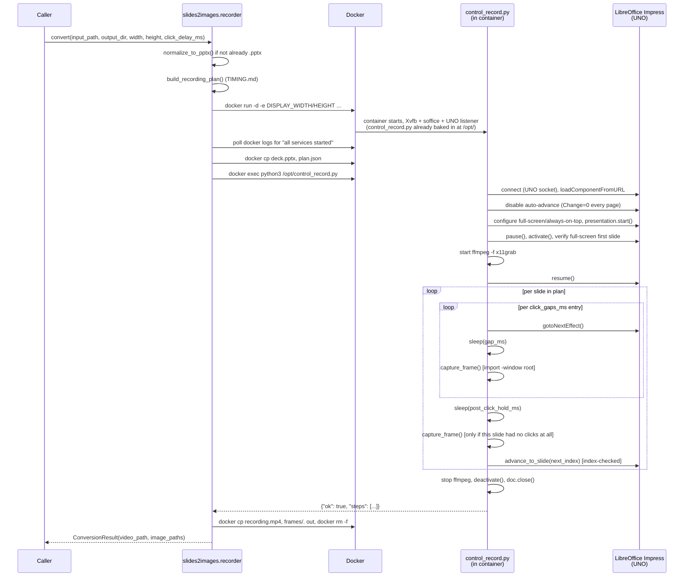

# Protocol: driving LibreOffice Impress, from `convert()` to Impress

How a `convert()` call travels all the way to a running
`docker-libreoffice-impress` container to LibreOffice Impress itself, and
back to a finished video. This is the operational counterpart to
`TIMING.md` (which computes *what* the timing should be) — this file
covers *how* that plan is actually executed. Source of truth is
`src/slides2images/recorder.py` (host-side orchestration, this repo) and
`control_record.py` (in-container UNO control, baked into the image at
`/opt/control_record.py` — see §1; lives in the separate
`docker-libreoffice-impress` project); this is the narrative version.

## Overview



The rest of this document covers each leg of that chain in depth.

## 1. Container shape

- Image: `jlesage/baseimage-gui:alpine-3.24-v4.12.6` base (the same
  Xvfb/Openbox/x11vnc/s6-overlay pattern `jlesage/docker-thunderbird` uses)
  plus the full `libreoffice` meta-package (not just `libreoffice-impress`
  — the split package alone aborts on bootstrap), ImageMagick (`import`,
  used for live per-click screenshots — see §10), ffmpeg, and
  `poppler-utils`.
- `rootfs/startapp.sh` is exec'd by the base image once its virtual
  display/supervision is ready. It launches `soffice` in **GUI mode** (not
  `--headless` — headless skips the X display entirely, defeating the
  purpose) with a UNO socket listener on `localhost:2002`.
- Display size is controlled by `DISPLAY_WIDTH`/`DISPLAY_HEIGHT` env vars
  (the base image's own Xvnc `-geometry` convention) — read by both the
  base image (to size Xvfb) and `control_record.py` (to size ffmpeg's
  `-video_size`, keeping capture in sync with the real display; a mismatch
  crops or pads the recording).
- **`control_record.py` is baked into the image itself**, at
  `/opt/control_record.py` — source lives in the separate
  `docker-libreoffice-impress` project (`rootfs/opt/control_record.py`
  there), copied in by that project's `COPY rootfs/ /` Dockerfile line,
  which also installs `startapp.sh`, placed *after* the expensive
  package/font install layers so editing the script only invalidates that
  one cheap layer, not a full rebuild. It's
  the same script on every run — only the per-job `.pptx` and computed
  `plan.json` get `docker cp`'d in at runtime (§3). It runs **inside** the
  container via `docker exec`, using the container's own bundled Python —
  `libreoffice-common` registers the `uno`/`unohelper` bindings directly
  into system Python's site-packages, no `PYTHONPATH`/pyuno-bridge
  gymnastics needed. This is "control strategy B" (vs. strategy A, an
  external client connecting to the exposed UNO socket — not used; the
  socket isn't even exposed by default, `EXPOSE 2002` is commented out in
  the Dockerfile).
- One container **per recording job**, not a shared long-lived instance.
  Reusing one `soffice` session across many decks was found to reliably
  `SIGABRT` after roughly a dozen consecutive
  `loadComponentFromURL`/`close()` cycles — a fresh container costs ~8s of
  startup but sidesteps the failure mode entirely.

## 2. Readiness

The container's `docker logs` output includes `"all services started"`
once Xvfb + `soffice` + the UNO listener are all up — poll for that string
(60s timeout has been sufficient in practice) before running anything
inside the container. There is no dedicated "UNO socket is accepting
`urp` handshakes" wait strategy; `connect()` (below) does its own
retry-on-connect-failure loop as a second layer.

## 3. From `convert()` to the container

Before any UNO call happens, `slides2images/recorder.py` sets up everything
the in-container script needs — this is the leg of the chain the sequence
diagram above labels `Recorder`/`Docker`:

1. **Normalize the format, if needed.** `slides2images.animation_timeline`'s
   timing computation goes through `python-pptx`, which only reliably
   opens the modern OOXML zip structure. Any upload that isn't already
   `.pptx` (legacy `.ppt`, or `.ppsx`/`.potx`/etc.) is converted first via
   a throwaway `docker run --rm --entrypoint soffice ... --convert-to
   pptx` container — the same image, just invoked headlessly instead of
   as a live slideshow.
2. **Compute the plan** — `build_recording_plan(pptx_path,
   click_delay_ms)` (host-side, no container needed; see `TIMING.md`).
3. **Start the recording container**, with the requested resolution
   passed as environment variables: `docker run -d -e
   DISPLAY_WIDTH=<w> -e DISPLAY_HEIGHT=<h>
   registry.gitlab.com/riphixel/docker-libreoffice-impress:latest`.
   This is the *only* place resolution enters the pipeline — everything
   downstream just captures whatever size the display was started at (see
   §1's `DISPLAY_SIZE` note).
4. **Wait for readiness** (§2), then copy in the two things that vary per
   job: the (now-normalized) `.pptx` and the plan as `plan.json` — via
   `docker cp`, not a bind mount, so the job's container has no dependency
   on the host filesystem layout persisting. `control_record.py` itself is
   *not* copied — it's already sitting in the image at
   `/opt/control_record.py` (§1).
5. **Run it**: `docker exec <container> python3 /opt/control_record.py
   --pptx ... --plan ... --output /tmp/output/recording.mp4 --frames-dir
   /tmp/output/frames`, capturing stdout (a single JSON object —
   `{"ok": bool, "steps": [...]}`, see §4) and the exit code.
6. **Copy the results back out** (`docker cp <container>:/tmp/output/recording.mp4
   ...` and `docker cp <container>:/tmp/output/frames/. ...` — the
   trailing `/.` copies the directory's *contents*, not a nested `frames/`
   subdirectory) and remove the container (`docker rm -f`) — always,
   success or failure, so a job never leaves a container running.

Each call's container is named `slides2images-<random>` and removed in a
`finally` block regardless of success or failure (§3 step 6). There's no
separate crash-recovery sweep: `convert()` is a stateless function, not a
long-running service with its own startup hook — if the calling process is
killed mid-conversion, the orphaned container is the caller's problem to
clean up (`docker ps --filter name=slides2images-`), the same as any other
subprocess it didn't get to wait on.

## 4. The control script's sequence (inside the container)

1. **Connect.** `uno.getComponentContext()` → resolve
   `uno:socket,host=localhost,port=2002;urp;StarOffice.ComponentContext`
   via `com.sun.star.bridge.UnoUrlResolver`, retrying on failure for up to
   30s (the listener may not be accepting the `urp` handshake the instant
   the log line appears).
2. **Load the document.** `Desktop.loadComponentFromURL(file://<path>,
   "_blank", 0, [Hidden=False])`. `Hidden=False` is required — a hidden
   load can't be driven as a live slideshow.
3. **Disable auto-advance, before starting the show.** Every draw page's
   `Change` property is set to `0` (advance-on-click; `1` = advance
   automatically after the page's own `advTm` timer). This is the single
   most important step in the whole protocol — see §5.
4. **Start the presentation in full-screen/always-on-top mode.** Set
   `IsFullScreen=True`, `IsAlwaysOnTop=True`, and `StartWithNavigator=False`,
   then call `start()`. As soon as a running controller is available, pause
   it so first-slide effects cannot run before recording starts.
5. **Activate and verify the slideshow UI.** Set the controller's
   `AlwaysOnTop=True`, call `activate()`, and wait until it reports all of:
   running, active, full-screen, paused, and positioned on the plan's first
   slide. `presentation.isRunning()` alone is insufficient: it can become
   true while the visible X11 window is still the Impress editor. Hold the
   verified full-screen first slide briefly so its first paint completes.
6. **Start recording.** `ffmpeg -f x11grab -video_size <DISPLAY_SIZE>
   -framerate 15 -draw_mouse 0 -i :0 -pix_fmt yuv420p -movflags +faststart
   <output>`, launched as a subprocess with a stdin pipe (needed for clean
   shutdown — see step 9). `-draw_mouse 0` matters: without it ffmpeg draws
   the real X11 cursor into every frame, and since nothing ever moves it
   during UNO-driven playback it just sits as a static artifact wherever it
   was last left.
7. **Lead-in and resume.** Hold the already-rendered, paused full-screen
   first slide for a short fixed interval (`LEAD_IN_S`, 0.3s), so ffmpeg has
   started capturing valid slide frames, then call `controller.resume()`.
8. **Drive the plan**, per slide, in order (see §5 for the plan format and
   §7 for the exact per-slide loop) — capturing one live screenshot per
   settled click along the way (`import -window root`, §10), not just
   recording video.
9. **Stop recording.** Send `b"q"` on ffmpeg's stdin — its own clean-shutdown
   request, which finishes writing the current frame and the mp4
   trailer/moov atom (a bare `SIGKILL` can leave a truncated/unplayable
   file). 10s timeout, then fall back to `kill()`.
10. **Deactivate and close**, both best-effort, **in that order after
    recording has already stopped**: `controller.deactivate()` can itself
    touch the screen, so it must not run while ffmpeg is still capturing.
    Then `doc.close(False)` (discard, no save).

## 5. The plan format (input contract)

A JSON array, one object per slide, in slide order:

```json
[{"index": 0, "click_gaps_ms": [1260, 5000], "post_click_hold_ms": 10}, ...]
```

Produced by `slides2images.animation_timeline`'s `build_recording_plan()` (see
`TIMING.md` for how each field is computed). `control_record.py` has no
`python-pptx`/`lxml` dependency itself — the plan is precomputed on the
host and handed in as a file (`--plan`), keeping the in-container script's
dependency footprint to just `uno` + stdlib.

The script's other two arguments are plain paths, not part of the plan
itself: `--output` (the recording's `.mp4` destination) and `--frames-dir`
(created if missing; gets one `frame-{slide_index}-{capture_index}.png`
per settled click, `capture_index` reset to 0 at the start of each slide,
plus one frame — `capture_index` 0 — for a slide with no click chains at
all — see §7 and §10).

## 6. Why auto-advance is disabled (the overshoot fix)

This is the load-bearing fix in the whole protocol, so it's worth stating
plainly: **slides with an `advTm` (advance-after-time) auto-advance
themselves**, independent of anything the control script does. If the
script *also* calls `gotoNextSlide()` on its own schedule, the two advance
sources race — a manual advance landing at the same moment as an
auto-advance moves the show two slides, not one. Across a deck this
compounds into overshoot: the show gets driven *past* its actual last
slide into Impress's native "Click to exit presentation…" end-of-show
screen, which then gets recorded as the final content — silently, since
`presentation.isRunning()` keeps reporting `True` even after this happens.

This was a real bug, found and fixed during development, and the fix —
plus how it was misdiagnosed at first — is worth keeping in full, since
the symptom ("last slide looks wrong") is exactly the shape a *different*
future bug in this area would also take.

**Demonstrated root cause.** Driving a fixture to its last slide with
blind `gotoNextSlide()` calls, a debug trace caught a single such call
jumping the current slide index from `1` straight to `3` — an `advTm`
auto-advance fired at the same moment and the two calls compounded.
Driving the *same* fixture with index-checked advancing (only call
`gotoNextSlide()` while genuinely behind the target — see §7) made the
last slide **stay visible at full brightness indefinitely**, no
placeholder at all.

**The fix**, two layers:

1. **Disable auto-advance at load (primary).** Every draw page's
   `Change` property is set to `0` (advance-on-click) before `start()` —
   see §4 step 3. No `advTm` timer ever fires, so manual driving is the
   **sole** advance mechanism, 1:1 correspondence between `gotoNextSlide()`
   calls and actual slide changes. The transition *effect* (fade, wipe,
   etc.) is unaffected; only the advance *trigger* changes. Per-slide
   durations are unaffected too — the timing model already bakes `advTm`
   into each slide's computed hold budget (`TIMING.md` §5), which the
   control script honors via its own sleep, not via Impress's timer. This
   also means a terminal slide that itself carries an `advTm` (e.g. a
   deck whose last slide has `advTm=300`) can't auto-advance off the
   *end* either — an earlier version instead called `controller.pause()`
   on such slides, which was a timing race (passed in isolation, failed
   under load); disabling auto-advance removes the race entirely.
2. **Index-checked advancing (defensive).** `advance_to_slide()` (§7) is
   still index-checked, in case layer 1 is ever unavailable — advancing
   only while genuinely behind the target absorbs an unexpected
   auto-advance instead of compounding it.

**Why the first diagnosis was wrong.** Before the real cause was found,
the symptom was investigated as "the terminal slide has no live window —
Impress never renders its real content when reached this way," because a
screenshot taken with *zero* added delay after arriving already showed
the placeholder. That observation was real but misattributed: the
screenshot was black at zero delay because the show had *already
overshot past* the slide before the screenshot was taken — not because
the slide itself couldn't render. Reaching the slide correctly
(index-checked) makes it render fine and hold indefinitely. The lesson:
"the screenshot is already black at zero delay" rules out a *timing race
on arrival*, but does NOT rule out *having arrived at the wrong place* —
worth remembering before chasing a similar-looking symptom down the
"no live window" path again.

**Dead ends tried before finding the real cause** (skip these if a
similar symptom resurfaces):

1. Capping the terminal hold to a tiny value — didn't help; the
   placeholder was already showing before the hold even started.
2. `controller.pause()` at various points (immediately on arrival,
   before/after `gotoNextSlide()`, navigating while already paused) — all
   still black, because the pause was landing on the already-overshot end
   screen, not on real content.
3. Frame synthesis — screenshot a verified-good frame, stop live capture,
   splice in a static-image hold clip for the remaining duration. Built,
   then removed once the real diagnosis showed there was nothing wrong
   with live capture to begin with.
4. Modifying the input `.pptx` to give the terminal slide "something to
   do" — injecting a `<p:transition>`, or a full `<p:timing>` click chain
   matching a working fixture byte-for-byte (valid `presetID`, correct
   `p:seq`/`prevCondLst`/`nextCondLst`/`bldLst` per the OOXML spec). None
   of it worked: the transition variants just briefly showed the incoming
   transition frame then went black (still overshooting afterward), and
   the injected-timing variants dropped to the LibreOffice *editor*
   window instead of either the slideshow or the placeholder. Moot once
   overshoot was identified as the real cause.
5. Sampling a single frame instead of the *timeline* delayed the correct
   diagnosis — one fixture's last slide was bright at t=0 but black by
   t=0.5s, and (separately) a non-terminal slide stayed bright forever
   when the driving script simply stopped advancing on it. Sampling over
   time on both is what showed the issue was about *reaching the slide
   at all*, not about what happens once there.

Confirmed fixed on every multi-slide fixture with `advTm` on early
slides, and on a fixture whose *last* slide itself carries an `advTm`. A
single-slide deck was never actually susceptible (it fires no
`gotoNextSlide()` at all, so there's nothing to overshoot with) despite
initially looking like a candidate by a structural marker alone —
worth remembering that the structural marker (a slide with no
click-triggered content) is not by itself proof of exposure to this bug;
confirm by actually sampling frames over time, the way this was found.

## 7. The per-slide control loop

For each plan entry, in order:

```python
slide_index = entry["index"]
capture_index = 0
for gap_ms in entry["click_gaps_ms"]:
    controller.gotoNextEffect()
    time.sleep(gap_ms / 1000.0)
    capture_frame(f"{frames_dir}/frame-{slide_index}-{capture_index}.png")  # §10 — live, not reconstructed later
    capture_index += 1

# hold whatever's left of the slide's total computed budget
time.sleep(total_budget_s - elapsed_s)

if not entry["click_gaps_ms"]:  # no clicks at all: one frame at the end of the hold instead
    capture_frame(f"{frames_dir}/frame-{slide_index}-{capture_index}.png")
    capture_index += 1

if not last_entry:
    advance_to_slide(controller, next_entry["index"])
```

- `gotoNextEffect()` fires the slide's next click-triggered animation
  chain; the sleep after it is exactly the plan's computed gap (no
  artificial floor or padding — an earlier version added both a 1.0s
  safety margin and a per-click screenshot+brightness verification
  (`looks_like_end_of_show()`) here, guarding against an over-firing
  `gotoNextEffect()` ending the show. Both were removed once disabling
  auto-advance (§6) was confirmed to make that over-firing harmless — a
  spurious `gotoNextEffect()` is now a no-op, not a show-ender — verified
  by re-running the previously check-triggering fixtures with no check at
  all and confirming correct output (§8).
- The screenshot lands *between* the sleep for this click and whatever
  comes next (the next click, or the slide-advance) — the latest point
  still guaranteed to belong to this click, before anything moves on. See
  §10 for why this replaced reconstructing frames from the video afterward.
- The deck's **last** slide never gets a `gotoNextSlide()` call at all —
  it just holds its content for the full computed budget, then recording
  stops. With auto-advance disabled it can't drift off the end on its own
  either.
- `advance_to_slide(controller, target_index)` — advances only while
  `controller.getCurrentSlideIndex() < target_index`, waiting (up to
  `ADVANCE_STEP_TIMEOUT_S=2.0s` per step) for the index to actually change
  after each `gotoNextSlide()` call before deciding whether another
  advance is needed. `ADVANCE_TOTAL_TIMEOUT_S=5.0s` bounds the whole
  per-slide advance.

## 8. Validation: recorded output vs. the computed plan

`TIMING.md` §7 validates the timing *model* alone (computed `total_slide_ms`
vs. a real-PowerPoint-rendered reference video, no live recording
involved). This section is the other half: does the actual recorded
`.mp4`, produced by driving live Impress through this whole protocol,
come out close to what the plan says it should?

`tests/test_video_recording.py::test_recording_duration_and_final_frame`
checks this per fixture, three independent ways:

0. **Frame count.** `--frames-dir` must contain exactly one
   `frame-{slide_index}-{capture_index}.png` per click in that slide's
   `click_gaps_ms` (or one, `capture_index` 0, for a click-less slide) —
   i.e. `control_record.py` captured a live screenshot at every point §7
   says it should have, no more, no fewer, each a real (non-empty) file,
   named by exactly which slide and which click produced it. This doesn't check *content*
   — that's what actually looking at the frames while debugging is for (see
   `debug_timing_graph.py` for the timing side of that) — just that the
   mechanism ran to completion for every click.
1. **Duration.** `ffprobe`'s reported duration of the recorded `.mp4`
   vs. `sum(click_gaps_ms) + post_click_hold_ms` per slide (summed over
   the plan) plus the fixed `LEAD_IN_S` (0.3s, §4 step 7) — within a
   `TOLERANCE_S` of 2.5s. That tolerance is deliberately loose: real-time
   X11 capture carries overhead a plan built from static XML analysis
   never sees — UNO round-trip latency on every `gotoNextEffect()` call,
   ffmpeg process start/stop, and Python-level `sleep()` drift — none of
   which is timing-model error, just the cost of driving a real
   application instead of computing durations offline. The point of this
   check is confirming duration scales sensibly with the plan, not
   frame-perfect timing.
2. **Final-frame content.** The recorded `.mp4`'s actual last frame is
   decoded and its mean grayscale brightness measured
   (`_last_frame_mean_brightness()`); a value at or below
   `END_OF_SHOW_MEAN_BRIGHTNESS_THRESHOLD` (0.05) means the recording
   ended on Impress's dark end-of-show placeholder rather than real slide
   content — the same signature §6's `looks_like_end_of_show()` used to
   check per-click before it was removed, now checked once, independently
   of the recorder's own self-report. Duration alone can't catch this: a
   recording that overshot onto the placeholder can still land at
   roughly the right total length, since the placeholder burns screen
   time too.

All 17 video fixtures pass all three checks (a dedicated,
duration-only test separately covers `no slide.pptx`, which has zero
slides and nothing to record). This is what actually caught the overshoot
bug described in §6 in the first place — the final-frame check failed
before the fix and passes after it, on every previously-affected fixture.

## 9. Known gaps in this protocol

- **`gotoNextEffect()` count can still be structurally wrong.** The plan's
  `click_gaps_ms` length is derived from counting `clickEffect`/`clickPar`
  nodes in the OOXML, which doesn't always match how many calls Impress's
  own click-grouping actually needs (a fixture with 2 sibling
  `clickEffect` groups in `mainSeq` was found to only need 1 real call in
  practice). With auto-advance disabled this no longer ends the show, but
  the animation can still be triggered earlier than authored if the extra
  click lands mid-sequence. Not fixed at the protocol level — belongs in
  the timing model's click detection (`slides2images.animation_timeline`).
- **No live progress/error signal beyond the final JSON result.** The
  script prints one JSON object (`{"ok": bool, "steps": [...], "plan":
  [...]}`) to stdout at the very end; there's no streaming status during a
  (potentially tens-of-seconds-long) recording.
- **`isRunning()` cannot detect "ended via overshoot"** — confirmed via a
  side-by-side repro, it keeps reporting `True` even after the show has
  fallen through to the exit placeholder. Any future detection logic needs
  a different signal (the removed screenshot-brightness check was one
  such signal; not currently reinstated since it's not needed for the
  fixture corpus tested).

## 10. Live frame capture (why not reconstruct frames from the video)

Static frames used to be produced entirely host-side, *after* the
recording finished: `slides2images.recorder.extract_static_frames()` would
take the plan's own cumulative timestamps, clamp them to the video's real
duration, and probe forward with `ffmpeg` for a moment that looked
"settled" — because the plan is computed offline (`TIMING.md`) and has no
way to know how long the *real*, live-driven recording actually took at
each step. That entire mechanism — `_nominal_frame_timestamps_s()`,
`_frame_settle_bounds_s()`, `_find_settled_timestamp_s()`, and the pixel-diff
probing under them — is gone now, replaced by `capture_frame()` inside the
per-slide loop itself (§7): a live `import -window root` screenshot taken
by the one process that actually knows, with certainty, when a click has
settled, because it's the process that just finished sleeping through that
click's own gap.

**Why the old approach broke, concretely.** `CLICK_DELAY_MS` (`TIMING.md`
§5) replaced the old `SLIDE_VISIBILITY_MS` policy with a much smaller
default (500ms vs. 5000ms) — deliberately, since this project's consumers
don't need PowerPoint's human-reading-time assumption. But a smaller
budget leaves less real slack for `advance_to_slide()`'s own cost (UNO
round-trips, slide-transition polling), and on `210314 hannover_messe.pptx`
(an 8-slide real-world deck) the very first extracted frame — slide 0's
own single frame, nominally captured at `LEAD_IN_S + post_click_hold_ms` =
0.8s — landed *after* the real slide 0→1 transition had already happened,
so it silently extracted slide 1's content under slide 0's index. No
amount of tightening the settle-search's safety margins could fix this in
general: the fundamental problem was reconstructing "what does the display
look like right now" from a plan computed *before* the recording ran,
when the real recording's own pacing can diverge from that plan by exactly
the kind of margin the reconstruction needed to stay inside.

**The fix removes the guess entirely.** Since `control_record.py` already
knows precisely when each click's sleep ends (§7's loop), it can just look
at the display *then* — no plan-vs-reality reconciliation needed on either
side of the `docker cp`. Verified on the same fixture that exposed the
bug: frame 0 is now the correct title slide, and every other frame in
that deck's most animation-heavy slide is now fully settled (previously,
several were caught mid-fade — see `TIMING.md`'s note on `CLICK_DELAY_MS`
for why short click gaps made this worse).

**Trade-offs accepted for now.** The recorded `.mp4` is still produced (a
useful artifact of its own, and what §8's duration/final-frame checks
still validate independently of the frame-capture mechanism), but nothing
currently extracts static frames *from* it — `ffmpeg`-based extraction is
dropped, not replaced by a second, independent source of frames. Live
capture also adds one `import` subprocess per click to the recording's own
wall-clock time, though this has so far been negligible next to the
`sleep()`s already dominating that loop.
