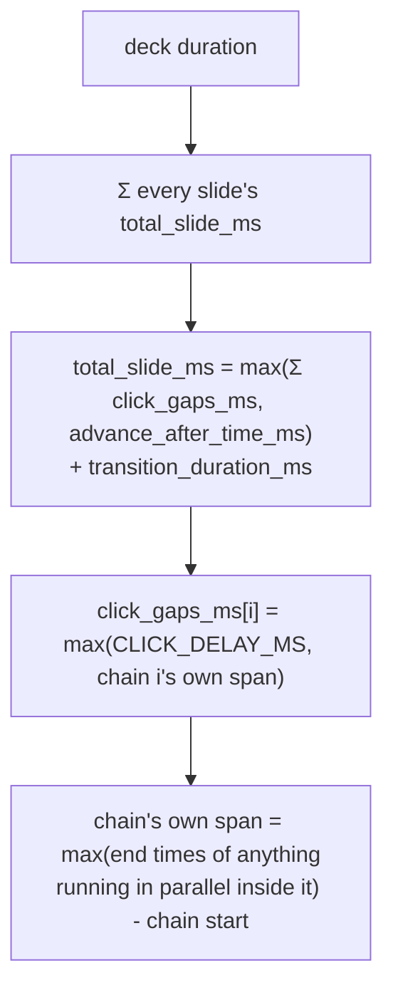
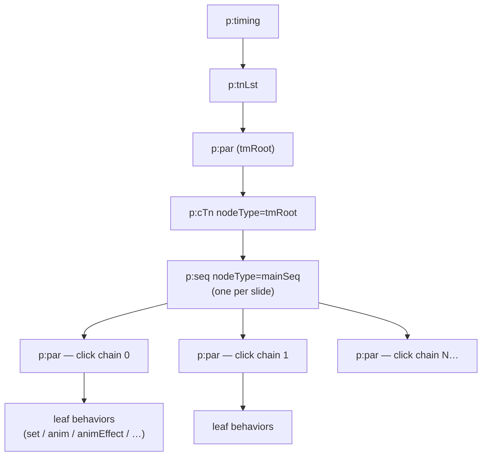
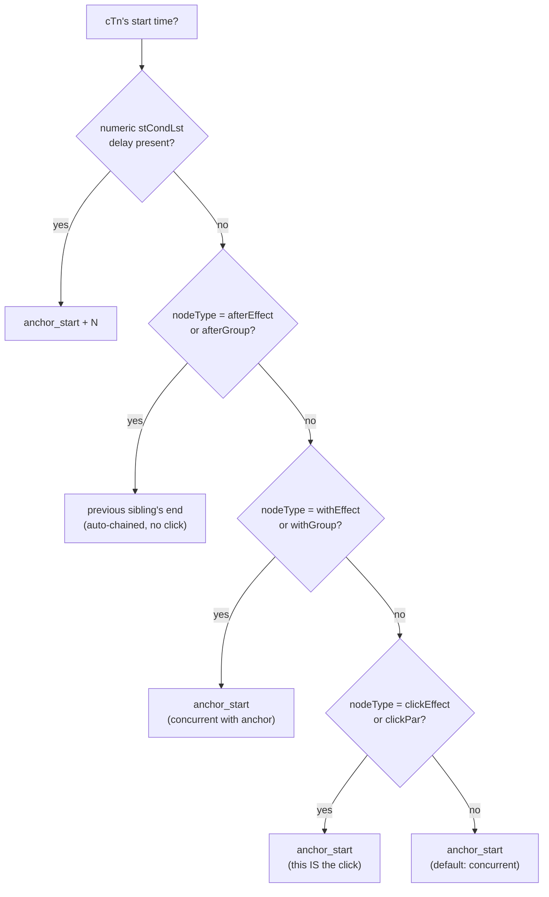

# Animation & transition timing computation

How `slides2images.animation_timeline` computes when every animation node
starts/ends, how long each slide takes, and how long the recorder waits
between clicks.

Source of truth for the model itself: `src/slides2images/animation_timeline.py`'s
own module docstring. This file is the narrative/debugging version — read
that file if the two ever disagree.

## 1. The model, top to bottom

1. **Deck duration** is the sum of every slide's `total_slide_ms`.
2. **A slide's duration** is:

   ```
   total_slide_ms = max(sum(click_gaps_ms), advance_after_time_ms) + transition_duration_ms
   ```

   - `advance_after_time_ms` is the slide's `<p:transition advTm="…">` value
     if the author set one explicitly, `0` otherwise.
   - `transition_duration_ms` (the visual fade/wipe/morph itself, `p14:dur`)
     is only added on top when `advTm` was explicit — see §4.2 for why.
3. **`click_gaps_ms[i]`**, the wait after firing a slide's `i`-th click
   (`gotoNextEffect()`), is:

   ```
   click_gaps_ms[i] = max(CLICK_DELAY_MS, chain[i]'s own span)
   ```

   `CLICK_DELAY_MS` (default 500ms) is a floor on the minimum time between
   two clicks, not a minimum *content-visibility* time — a deliberate
   departure from PowerPoint's own human-reading-time slide-duration
   default. This project's consumers (VLM analysis, general automated use —
   see `features.md`) need each click's own effect to have visibly settled,
   and no more.

   A chain's "own span" (§3.1) already accounts for animations running in
   parallel within it, so this single `max()` against the floor covers
   click chains with several concurrent animations just as well as
   single-animation ones.
4. Every top-level `<p:par>` under a slide's `mainSeq` is one click chain,
   by construction (§2) — counting them tells you how many
   `gotoNextEffect()` calls a slide needs.



`build_recording_plan()` trims a slide's computed timing down to the three
fields `control_record.py` actually consumes: `{index, click_gaps_ms,
post_click_hold_ms}`, where `post_click_hold_ms = total_slide_ms -
sum(click_gaps_ms)`.

## 2. Where this lives in the XML

Each slide's animation timing is a tree under `<p:timing>`, a sibling of
`<p:cSld>` inside `ppt/slides/slideN.xml`:



- `tmRoot` is always a single `<p:par>` wrapping one `<p:cTn nodeType="tmRoot">`.
- Its one child is `<p:seq nodeType="mainSeq">`.
- `mainSeq`'s `childTnLst` holds one **top-level `<p:par>` per click chain**
  — everything that unfolds from one `gotoNextEffect()` call, in document
  order.
- Below that, each node is one of: `<p:par>` (children start together),
  `<p:seq>` (children chained one after another), or a bare list of leaf
  **behavior** elements (`set`, `anim`, `animClr`, `animEffect`,
  `animMotion`, `animRot`, `animScale`, `cmd`, `audio`, `video`) — these are
  the actual things that change something on screen.
- The slide-to-slide **transition** (`<p:transition>`) is a *sibling* of
  `<p:timing>`, not part of it — the fade/wipe/morph between slide N-1 and
  slide N, not an in-slide animation. Documented separately in §4.

Every `<p:par>`/`<p:seq>`/leaf-behavior element's timing data lives on its
own `<p:cTn>` (Common Time Node) — a direct child for `par`/`seq`, or nested
under `<p:cBhvr><p:cTn>` for leaf behaviors. `_own_cTn()` in the script
normalizes this lookup.

## 3. Resolving one node's span and start time

### 3.1 Span (duration)

A `<p:cTn>`'s **intrinsic span** (before any repeat multiplier) is:

- its own `dur="N"` attribute, if present and numeric (`"indefinite"` means
  open-ended — recorded as `null`, never guessed at); otherwise
- for a `<p:par>`/`<p:seq>` wrapper with children: the children's own
  computed span (`max(child end times) - this node's start` for a `<p:par>`,
  or the running chain end for a `<p:seq>`); otherwise
- unknown (`None`) — genuinely open-ended (no `dur`, no children).

`repeatDur`, when present, **overrides** the `repeatCount`×span product
entirely and becomes the final span directly — it's a hard cap on total
repeated time, not a multiplier target.

`repeatCount` is a **thousandths-of-a-repeat multiplier** (`"5000"` = 5
repeats, `"1000"` = 1 repeat / no extra), applied to whichever intrinsic
span the node resolves to. The multiplier attribute and the `dur` it
multiplies don't have to live on the same node — a `repeatCount`-bearing
wrapper `<p:cTn>` commonly carries no `dur` of its own, only its children
do, so the multiplier has to be applied to the children-derived span, not
just an own-`dur` value.

The `repeat_count` field on each `TimelineNode` in the JSON output is
always this multiplier (`raw_repeatCount / 1000.0`, or `1.0` if absent) —
even on a node where it had no effect because a sibling/child carried the
actual `dur`. It documents what multiplier *would* apply to that node's own
span, not necessarily what was used to compute `end_ms`.

### 3.2 Start time

For a given `<p:cTn>`, its start time is resolved against an **anchor**
(normally its parent's start time) in this priority order:



1. **Numeric `stCondLst` delay.** `<p:cTn><p:stCondLst><p:cond delay="N"/>`
   with `N` a plain integer → starts `anchor_start + N` ms, regardless of
   `nodeType`. Highest priority; overrides everything below when present.
2. **`nodeType="afterEffect"` / `"afterGroup"`.** No numeric delay (or
   `delay="indefinite"`) → starts when the *preceding sibling* in the same
   `childTnLst` ends. This is how "one effect after another, no click
   needed" auto-chains are expressed. If there's no preceding sibling,
   falls back to the anchor's own start and a warning is recorded.
3. **`nodeType="withEffect"` / `"withGroup"`.** Starts at the anchor's own
   start time — concurrently with whatever it's nested inside.
4. **`nodeType="clickEffect"` / `"clickPar"`.** Also starts at the anchor's
   start time. The distinction from `with*` is semantic (this node's own
   position in a `mainSeq` chain already encodes when its click happens),
   not a different start-time formula.
5. **Nothing matches** → inherits the anchor's start (concurrent-by-default,
   matching a bare `<p:par>`'s implicit "starts with parent" semantics).

**Corner cases**, each flagged via a `warnings` list rather than silently
mishandled, none exercised by the current fixture corpus except the first:

- `delay="indefinite"` with no `evt`, or `evt="onClick"`/`"onNext"` — "wait
  for an external trigger" per `TriggerEventValues`, with no fixed timer to
  resolve from the XML alone. Modeled as "happens at the anchor's start",
  because at the depth this occurs (wrapping a `mainSeq` top-level
  `<p:par>`), the anchor's start *is* this chain's click in our model. Any
  other `evt` paired with `delay="indefinite"` is out of scope.
- Multiple `<p:cond>` conditions in one `stCondLst` (multi-condition start
  sync, e.g. "start after A finishes AND after B finishes") — only the
  first is used.
- `<p:rtn>` inside a `<p:cond>` (a condition referencing another time
  node's start/end instead of a plain delay) — treated as anchor-relative.

## 4. Slide transition (`<p:transition>`)

Lives outside `<p:timing>`, as a sibling of `<p:cSld>`. Two attributes
matter for pacing:

- `advTm` (bare attribute, milliseconds) — "advance to the next slide after
  this many ms". **Absent means "no auto-advance occurs" per spec** — it is
  *not* itself a default; that concept is this project's own
  `CLICK_DELAY_MS` policy (§1), applied only when `advTm` is missing.
- `p14:dur` (**namespaced**, `http://schemas.microsoft.com/office/
  powerpoint/2010/main` — an Office 2010+ extension) — how long the visual
  transition effect itself (fade/wipe/morph) takes. A bare, unnamespaced
  `dur` attribute never matches a real file; the attribute genuinely only
  exists under the `p14:` namespace.

### 4.1 `<p:transition>` wrapped in `<mc:AlternateContent>`

Real decks commonly ship **two** copies of the transition, guarded by
Markup Compatibility (`mc:`) so older PowerPoint versions degrade
gracefully:

```xml
<mc:AlternateContent xmlns:mc="http://schemas.openxmlformats.org/markup-compatibility/2006">
  <mc:Choice xmlns:p14="http://schemas.microsoft.com/office/powerpoint/2010/main" Requires="p14">
    <p:transition p14:dur="10" advTm="1000"/>
  </mc:Choice>
  <mc:Fallback>
    <p:transition advTm="1000"/>
  </mc:Fallback>
</mc:AlternateContent>
```

A direct-child search (`slide_el.find("p:transition")`) misses this
entirely — the real element nests one level deeper, under `mc:Choice`, not
a direct child of `<p:sld>`. The fix is searching recursively
(`.//p:transition`), which lands on the `mc:Choice` copy (fuller,
`p14:dur`-bearing) since it precedes `mc:Fallback` in document order in
every fixture checked.

### 4.2 Does `p14:dur` stack on top of `advTm`, or not?

**Rule:** `transition_duration_ms` is added to `advance_after_time_ms` only
when the slide's own `<p:transition>` specifies `advTm` explicitly. When
`advTm` is absent and the `CLICK_DELAY_MS` fallback governs instead, the
transition's visual duration is *not* added on top.

Working theory, not spec-confirmed: PowerPoint's "seconds spent on each
slide" default is a floor on total time-until-next-slide-shown, already
generous enough to include a typical transition; an *authored*,
deliberately short `advTm` is presumably tuned without accounting for the
transition's own time, so it needs to be added back explicitly.

## 5. Known limitations

Flagged via a `warnings` list when encountered, never silently
mis-computed:

- `<p:iterate>` — paragraph/word/letter-by-letter text build timing.
- `<p:rtn>` / cross-references to another time node's start/end inside a
  `<p:cond>` (§3.2).
- `<p:endSync>`, `<p:subTnLst>`.
- Media bookmarks (`onMediaBookmark` trigger event).
- Open-ended nodes (`dur="indefinite"`, no `repeatDur`, no children with a
  known end) have `end_ms = null` — genuinely unknowable from the XML
  alone. Their click chain falls back to `CLICK_DELAY_MS` for pacing, same
  as any other open-ended/degenerate chain.
- `nodeType` values `interactiveSeq`, `clickPar`, `withGroup`, `afterGroup`
  are resolved by the same generic rules as their more common counterparts
  but are less exercised against the current fixture corpus (no
  paragraph-by-paragraph text builds in it).
- **Autoplay chains counted as needing a click.** Every top-level `mainSeq`
  child is currently assumed to be click-triggered (§2), but a chain can
  actually *auto-start* instead — a numeric `stCondLst` delay combined with
  an `onBegin` start condition, or a `withEffect`/`afterEffect` nodeType at
  that depth, both mean "plays on its own, no click needed." The model
  still emits a `click_gaps_ms` entry for these, causing one extra,
  unneeded `gotoNextEffect()` call. Harmless to the recording's outcome
  (see `IMPRESS_PROTOCOL.md`'s overshoot handling — final content and total
  duration end up correct regardless), but it can nudge an auto-playing
  animation's start earlier than authored if the spurious click lands
  mid-sequence. The correct fix — emit a click only for a chain containing
  an actual `clickEffect`/`clickPar` descendant, otherwise fold its
  duration into the hold instead of `click_gaps_ms` — hasn't been made yet.

## 6. See also

- `tests/test_animation_timeline.py`'s `EXPECTED_TOTAL_MS` — the current
  model's regression-locked numbers per fixture.
- `IMPRESS_PROTOCOL.md` — how a computed plan is actually executed against
  a live Impress instance: UNO connection sequence, auto-advance disabling,
  the per-slide control loop, container lifecycle.
- `features.md` — end-user-visible feature list.
